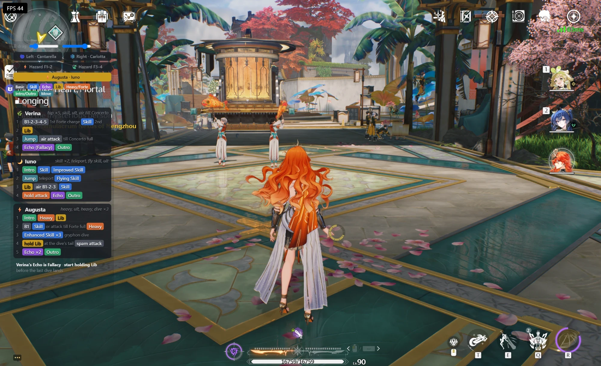

# rotation-overlay

A small always-on-top window that shows combat rotations next to the game: a picker (games, then
teams), coloured chips per action, optional key labels, a collapse-to-bar button and two opacity
sliders. Rotations are plain JSON files under `rotations/`, read at runtime, so editing one
updates the open window without a rebuild. Electron + electron-vite + React, styled with Vanilla
Extract and one theme, `src/renderer/src/styles/theme.css.ts`.



## Dev

```bash
npm install
npm run dev
```

- Dev server runs on port **5175**.
- UI edits and rotation JSON both hot-reload. Main/preload edits restart the app.
- `npm test` runs the Vitest suites, `npm run typecheck` checks both tsconfigs.

Day-to-day: `npm run build` once, then `npm start`. Rotation edits still apply live in the built
copy; only code changes need a rebuild.

Opening the dev URL in a plain browser works too: no app bar, an opaque page and a pop-out
button, with the rotations bundled by Vite instead of read by Electron.

## Adding a rotation

One team per file: `rotations/<game>/<members-in-field-order>.json`, kebab-case, in slot order
1-2-3 (e.g. `rotations/wuwa/chisa-rebecca-cantarella.json`). The folder is the game, the
filename is the members; neither is repeated inside the file.

```json
{
  "label": "🌀 Left · Cantarella",
  "order": 1,
  "variants": [
    {
      "id": "standard",
      "label": "Standard",
      "units": [
        {
          "icon": "✂️",
          "name": "Chisa — opener",
          "summary": "cut, ult",
          "steps": [
            [{ "type": "skill", "label": "Cut", "key": "E" }, { "note": "wait for the mark" }],
            [{ "type": "lib", "label": "Ult", "key": "R" }]
          ],
          "note": "repeat from Rebecca"
        }
      ],
      "tips": ["**Swap** after the second cut"]
    }
  ]
}
```

- The picker lists games by folder, then a game's teams by `order`, then filename. The first
  variant is the default; a team with one variant shows no variant tabs.
- Chip `type` must be one of the file's game's types (the game is the folder):

  | game | type | legend label | default key |
  |---|---|---|---|
  | `wuwa` | `basic` | Basic | none |
  | `wuwa` | `skill` | Skill | none |
  | `wuwa` | `echo` | Echo | none |
  | `wuwa` | `lib` | Lib | none |
  | `wuwa` | `heavy` | Heavy/Forte | none |
  | `wuwa` | `io` | Intro/Outro | none |
  | `wuwa` | `move` | Move | none |
  | `genshin` | `normal` | Normal | LMB |
  | `genshin` | `charged` | Charged | hold LMB |
  | `genshin` | `plunge` | Plunge | LMB (airborne) |
  | `genshin` | `skill` | Skill | E |
  | `genshin` | `burst` | Burst | Q |
  | `genshin` | `swap` | Swap | none |
  | `genshin` | `move` | Move | none |

- `key` is shown when the *keys* box is ticked. A chip's own `key` overrides the default, and a
  type with no default shows none, so a Genshin skill needs a `key` only when it isn't `E`. For
  something like "hold E", write it on the chip as `"key": "hold E"`.
- Genshin units may carry an `element` (`anemo`, `geo`, `electro`, `dendro`, `hydro`, `pyro` or
  `cryo`), which tints the unit's card. It is an error in any other game's file.
- A step is one numbered row of chips and `{ "note": … }` items.
- Tips join with ` · `; `**bold**` is their only markup.
- Every object is strict: an unknown key is an error. A bad file is listed on the picker under its
  game as a card naming the file and the failing field (an unknown folder or a loose file goes
  under "Other"), and the other teams keep working. An open team whose file goes bad shows its
  error card in place, and the back control carries a ⚠ count while any other file fails.

The schema itself is `src/renderer/src/data/schema.ts` (zod, built per game); the hand-written
types beside it must accept the schema's output (checked one way).

## Future TODOs

- HSR rotations.
- Share a rotation file (export / import).
- Revisit the styling approach.
